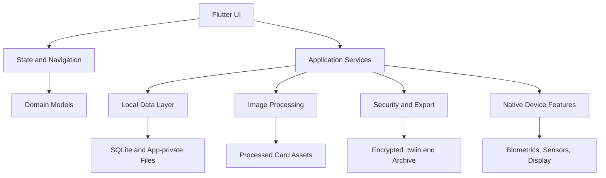
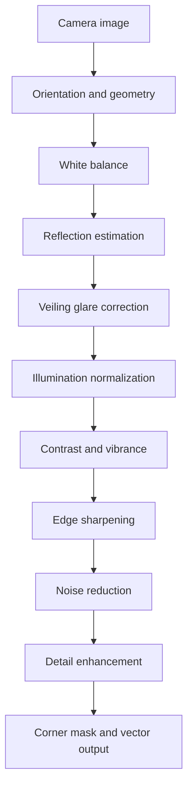
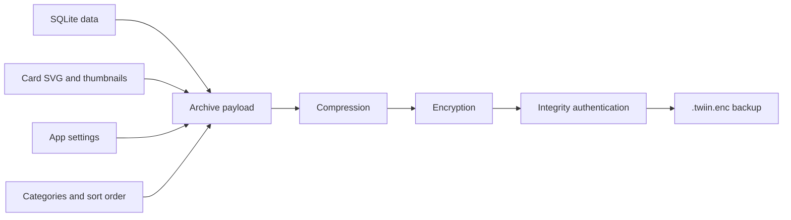

<div align="center">

  

  # Twiin

  ### Your cards. Digitally reimagined. Privately stored.

  **A digital card and document wallet built around local storage, thoughtful security, and realistic 3D interactions.**

  <p>
    <a href="https://flutter.dev"></a>
    <a href="https://dart.dev"></a>
    
    
    <a href="LICENSE"></a>
  </p>

  [Explore the project](#-what-is-twiin) · [How it protects your data](#-privacy--security) · [Technical deep dive](#-under-the-hood) · [Run locally](#-run-the-project)

</div>

---

## Your everyday cards, in one private place.

Twiin helps you keep useful physical cards and documents available on your phone. Capture a card, refine how it looks, organize it, and open it when you need it.

It is designed for the things people actually carry: identity cards, membership cards, tickets, passes, and other important documents.

**The idea is simple:** make your digital wallet convenient to use, clear to understand, and careful with personal information.

### What you can do with Twiin

- **Keep cards together** — organize cards, IDs, passes, tickets, and documents in one app.
- **Create cleaner digital copies** — crop and process card images to improve alignment, lighting, contrast, and readability.
- **View cards in 3D** — use device motion for a natural tilt effect and flip between the front and back.
- **Find what you need** — group, pin, and reorder cards.
- **Prepare a physical backup** — arrange card fronts and backs on an A4 printable sheet.
- **Keep a backup you control** — export and restore an encrypted `.twiin.enc` archive.

> **A useful distinction:** Twiin stores digital references to your cards. It does not turn a scanned image into a bank card, NFC credential, government-issued identity, or payment authorization. Use the original card whenever a service requires it.

---

## Privacy is part of the design.

Personal cards can contain names, numbers, photographs, and other sensitive details. Twiin is designed to keep its core card-management workflow on the device rather than requiring a cloud account.

### How the app protects card data

| Protection | What it means |
|---|---|
| Local storage | Card records and assets are stored in the app's private storage area. |
| Encrypted fields | Sensitive database fields are encrypted before being written to SQLite. |
| Encrypted backups | Exported vault archives use AES-256 encryption and an integrity check. |
| App lock | The app supports PIN-based access and device biometrics where available. |
| Recovery controls | PIN recovery questions are available as a secondary recovery mechanism. |
| Session handling | The app locks and clears selected in-memory sensitive state when it moves into the background. |

### A few honest security notes

- Encryption is one layer of protection, not a guarantee against every form of device compromise.
- Keep your device operating system updated and use a secure screen lock.
- Your encrypted backup is only useful if you can remember and safely retain the credentials needed to restore it.
- A printed card or screenshot is not protected by the app's encrypted vault.
- Do not use Twiin as a substitute for an official digital identity, bank wallet, or payment application.

---

## See what makes Twiin different

| Everyday need | Twiin's approach |
|---|---|
| Cards are scattered across photos and files | A dedicated, organized card collection |
| Scans look tilted or uneven | Four-point perspective correction and image processing |
| Card images look flat | Motion-driven 3D tilt and front/back interaction |
| Sensitive information needs care | Local app storage and encrypted sensitive fields |
| You need a physical copy | A4 layout with card-sized placement and alignment guides |
| Moving to another device | Encrypted export and import archive |

---

## Card types

Twiin includes visual layouts for several common card and document types.

| Type | Examples |
|---|---|
| Payment cards | Debit and credit card references |
| Identity cards | Personal identity and membership IDs |
| Boarding passes | Flight and travel passes |
| Transit tickets | Public transport and event tickets |
| Memberships | Loyalty and member cards |
| Coupons and rewards | Vouchers and reward cards |
| Access cards | Workplace and building access references |
| Documents | Other useful card-sized records |

---

# Under the hood

The sections below explain how Twiin is structured and how its main engineering systems work.

## Architecture

Twiin is organized around domain-focused services and a Flutter presentation layer. UI state and navigation are kept separate from image processing, storage, export, and platform-specific functionality.



### Main layers

- **Presentation:** screens, widgets, card interactions, and user workflows.
- **State and routing:** `ValueNotifier`-based state and `GoRouter` navigation.
- **Domain:** card entities, OCR results, vector-generation results, and export models.
- **Services:** image processing, OCR, database access, security, PDF generation, and updates.
- **Platform integration:** device sensors, biometrics, display brightness, and private app storage.

Expensive image-processing and archive operations are dispatched to background Dart workers where implemented, helping keep the UI responsive.

## Codebase map

```text
lib/
├── main.dart
├── core/
│   ├── app_router.dart
│   ├── app_notifiers.dart
│   └── core.dart
├── models/
│   ├── digitized_card.dart
│   ├── card_entity_result.dart
│   ├── vector_generation.dart
│   ├── app_release_info.dart
│   ├── export_result.dart
│   ├── security_question.dart
│   └── models.dart
├── services/
│   ├── vector_generator_service.dart
│   ├── security_vault_service.dart
│   ├── card_database_service.dart
│   ├── card_entity_extractor_service.dart
│   ├── a4_pdf_service.dart
│   ├── data_export_service.dart
│   ├── card_color_service.dart
│   ├── auth_service.dart
│   ├── update_service.dart
│   ├── system_info_service.dart
│   ├── security_questions_service.dart
│   ├── version_control_service.dart
│   └── services.dart
├── theme/
│   ├── app_theme.dart
│   └── theme.dart
├── screens/
│   ├── home_screen.dart
│   ├── card_detail_screen.dart
│   ├── card_studio_screen.dart
│   ├── card_scanner_screen.dart
│   ├── card_corner_crop_screen.dart
│   ├── card_print_screen.dart
│   ├── app_lock_screen.dart
│   ├── pin_setup_sheet.dart
│   ├── settings_screen.dart
│   ├── pass_capture_screen.dart
│   ├── qr_scanner_screen.dart
│   ├── privacy_policy_screen.dart
│   ├── update_download_screen.dart
│   └── splash_screen.dart
└── widgets/
    ├── wallet_card_shapes.dart
    ├── reorder_cards_sheet.dart
    ├── embossed_button.dart
    └── sheets/
```

---

## Computer vision and image reconstruction

A card photo can contain perspective distortion, uneven lighting, glare, sensor noise, and soft text. Twiin's image-processing service applies a multi-stage pipeline intended to improve the visual quality of captured cards.

### Processing pipeline



The documented pipeline includes:

1. **Orientation and geometry normalization** — standardizes card orientation and uses card geometry as a reference.
2. **Hybrid Gray-Edge white balance** — combines spatial edge information with channel averages to estimate color balance.
3. **Reflection estimation** — identifies likely specular glare and estimates the underlying diffuse color.
4. **Dark-channel glare correction** — reduces low-contrast veiling effects.
5. **Multi-scale Retinex normalization** — compensates for uneven illumination and shadows.
6. **Perceptual vibrance and contrast** — adjusts color and tonal separation.
7. **Shock filtering** — sharpens selected edge transitions.
8. **Bilateral denoising** — reduces image noise while aiming to preserve edges.
9. **Adaptive unsharp masking** — restores selected high-frequency details.
10. **Subpixel corner masking and vector output** — creates rounded card boundaries and a scalable SVG representation.

### ISO card geometry

For standard ID-1 card layouts, the reference dimensions are:

- Width: `85.60 mm`
- Height: `53.98 mm`
- Corner radius: `3.18 mm`
- Aspect ratio: approximately `1.5858`

These dimensions are used as a geometry reference for card-shaped layouts and printing. Not every document or ticket uses the ID-1 format.

### OCR and text extraction

Twiin uses Google ML Kit Text Recognition for on-device text recognition. Extracted text is represented through the card entity model and can support the card-capture workflow.

OCR is an aid, not a source of truth. Always review extracted names, numbers, and dates before relying on them.

---

## 3D interaction and device sensors

The card detail experience uses device motion to make a digital card respond to how the phone is held.

The documented interaction system includes:

- Accelerometer and gyroscope input through `sensors_plus`.
- Exponential smoothing to reduce small sensor fluctuations.
- Perspective transformation for depth.
- A 180-degree Y-axis flip to reveal the reverse side.
- A specular-style visual treatment for the card surface.

### Motion smoothing

The target angle is smoothed over time to reduce jitter:

\[
\theta_t = \theta_{t-1} + \alpha(\theta_{\text{target}}-\theta_{t-1})
\]

The documented smoothing factor is `α = 0.15`.

### Display brightness

The card detail flow can request maximum display brightness while a card is open and restore the previous brightness when leaving that view. This is intended to improve visibility at optical scanners; actual scan compatibility depends on the scanner, display, and card format.

---

## Privacy and security implementation

This section describes the mechanisms documented in the current codebase. It is an implementation overview, not a third-party security audit.

### Local vault and database

- The app uses SQLite for persistent card data.
- Sensitive fields are encrypted at the application layer before database persistence.
- Vault assets are stored in the app's private storage directory.
- The documented vault directory uses restrictive POSIX permissions where supported by the platform.

### Cryptography

The security service documents the following components:

| Component | Purpose |
|---|---|
| AES-256 | Encryption for sensitive data and vault archives |
| SHA-256 | Hashing and integrity-related operations |
| PBKDF2 | Deriving key material from a PIN with a salt |
| HMAC-SHA256 | Authenticating exported archive contents |

The exact security properties depend on key generation, nonce/IV handling, authentication mode, password derivation parameters, and implementation details. Review the implementation before making claims about resistance to specific attacks.

### Authentication and app lifecycle

- PIN setup supports 4- or 6-digit PINs.
- Biometric authentication is supported where the device provides it.
- PIN fallback is available when biometric authentication cannot be used.
- Progressive lockout is documented for repeated incorrect PIN attempts.
- Selected sensitive in-memory state is cleared and the app is locked during background lifecycle transitions.

### Encrypted backup format

Twiin's export service creates a `.twiin.enc` archive containing the app data and associated assets.



Keep a copy of your backup and the credentials required to restore it in a safe place. Do not share an unencrypted export or your PIN.

---

## A4 print engine

The print service creates a printable sheet with front and back card layouts.

The documented print features include:

- ID-1 card dimensions for supported card layouts.
- Front/back placement and alignment guides.
- Fold and cut guides.
- High-resolution resampling for print output.

Printer scaling, margins, paper handling, and alignment vary by printer. For accurate dimensions, print at **100% / Actual Size** and verify the output with a ruler before relying on it.

---

## Performance and release optimization

The Android release configuration documents several size and performance optimizations:

- Resource shrinking.
- R8 code shrinking and optimization.
- Native library packaging configuration.
- Locale resource filtering.
- Per-ABI APK builds.

The final APK size depends on Flutter, plugin versions, build settings, and target architecture. Measure the generated release artifacts rather than relying on a fixed size claim.

---

# Run the project

## Requirements

- Flutter SDK `3.24.0` or later
- Dart SDK `3.5.0` or later
- Android SDK with API level 26 or later for Android builds
- JDK 17 or later
- Xcode for iOS builds (macOS required)

## Clone and install

```bash
git clone https://github.com/sanjay434343/Twiin.git
cd Twiin

flutter pub get
```

## Check the project

```bash
flutter analyze
flutter test
```

## Run on a connected device

```bash
flutter run
```

## Build Android release APKs

```bash
flutter build apk \
  --release \
  --split-per-abi \
  --obfuscate \
  --split-debug-info=build/app/outputs/symbols \
  --tree-shake-icons
```

---

## Technology stack

| Area | Technology |
|---|---|
| App framework | Flutter |
| Language | Dart |
| Navigation | GoRouter |
| Local database | SQLite (`sqflite`) |
| Text recognition | Google ML Kit |
| Device motion | `sensors_plus` |
| Vector rendering | `flutter_svg` |
| PDF generation | Dart PDF tooling |
| UI system | Material 3 |
| Authentication | Native biometric APIs and app PIN flow |

---

## Contributing

Contributions, bug reports, and practical suggestions are welcome.

1. Fork the repository.
2. Create a focused feature branch.
3. Make the change and add or update tests where appropriate.
4. Format and analyze the code.
5. Open a pull request with a clear explanation of the change.

```bash
git checkout -b feature/your-feature
dart format lib test
flutter analyze
flutter test
git commit -m "feat: describe your change"
```

Please avoid including real identity documents, payment card details, personal information, or production vault backups in issues and pull requests.

---

## License

Twiin is distributed under the [MIT License](LICENSE).

---

<div align="center">

  **Twiin — useful cards, a calmer wallet, and privacy kept close.**

  <sub>Built with Flutter and Dart.</sub>

</div>
