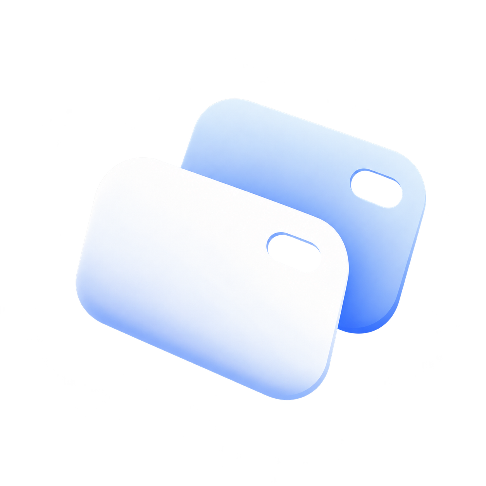
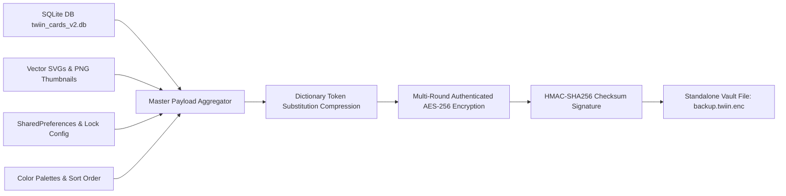
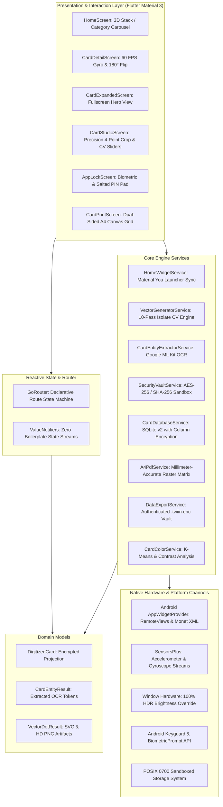

<div align="center">

  

  # Twiin
  ### The Hardware-Secured, Real-Physics Digital Card & Document Engine

  [](https://flutter.dev)
  [](https://dart.dev)
  [](https://android.com)
  [](https://material.io)
  [](https://github.com/sanjay434343/Twiin)
  [](https://www.iso.org/standard/70483.html)
  [](LICENSE)

  <p align="center">
    <b>Transform physical cards, IDs, passes, and documents into hyper-realistic, 3D interactive, mathematically enhanced digital twins.</b><br/>
    <i>100% Offline • Zero Telemetry • Material You Home Widget • 60 FPS Gyroscopic Physics • Real-Time Privacy Lock • Subpixel Vector Reconstruction</i>
  </p>

  <p align="center">
    <a href="#-why-twiin-key-benefits">Why Twiin?</a> •
    <a href="#-android-material-you-home-screen-widget">Home Widget</a> •
    <a href="#-3d-interactive-card-engine--turnstile-scanner-mode">3D Physics</a> •
    <a href="#-multi-user-profile-system">Profiles</a> •
    <a href="#-computer-vision--mathematical-pipeline">Scientific Pipeline</a> •
    <a href="#-security-vault--cryptography">Security Vault</a> •
    <a href="#-a4-print-engine--hardware-replication">A4 Print Engine</a> •
    <a href="#-system-architecture">Architecture</a> •
    <a href="#-developer-setup--workflow">Setup Guide</a>
  </p>

</div>

---

## 🌟 Why Twiin? (Key Benefits)

Traditional digital wallets and cloud pass managers treat cards as flat, low-res bitmaps or vendor-locked tokens, frequently sending your sensitive identity credentials to third-party cloud servers. Camera scans often suffer from tilted perspective distortion, harsh flash glare, high-ISO sensor noise, and illegible barcodes under point-of-sale laser scanners.

**Twiin** bridges the physical and digital worlds through **deterministic on-device computer vision**, **high-entropy cryptographic sandboxing**, and **real-time 60 FPS gyroscopic physics**.

```
┌─────────────────────────────────────────────────────────────────────────────────────────────┐
│                                    THE TWIIN ADVANTAGE                                     │
├────────────────────────────────┬────────────────────────────────────────────────────────────┤
│ ❌ Conventional Wallets & Scanners│ ✅ Twiin Digital Twin Architecture                        │
├────────────────────────────────┼────────────────────────────────────────────────────────────┤
│ Remote cloud surveillance      │ 100% Offline, Zero-Knowledge Kernel Sandbox (.twiin_vault) │
│ Flat, lifeless 2D screenshots  │ Real-time 60 FPS gyroscopic 3D tilt & 180° perspective flip│
│ Flash reflections & dark scans │ 10-stage Isolate CV pipeline (Retinex, Shock Filter, L₄)   │
│ Sluggish app opening at gates  │ Google Material You Home Widget with 1-tap instant expand  │
│ Barcode scanner failures       │ Automatic 100% HDR hardware screen brightness override     │
│ Visible sensitive card numbers │ Real-time privacy blur on home screen + lock masking       │
│ Mixed family/work cards        │ Multi-user profile switching with isolated passcodes       │
│ Lost or damaged physical cards │ 1:1 true-scale millimeter-accurate dual-sided A4 printing  │
│ Generic credit card shapes     │ 8 universal physical geometries (IDs, passes, badges, etc) │
└────────────────────────────────┴────────────────────────────────────────────────────────────┘
```

---

## 📱 Android Material You Home Screen Widget

Twiin features a state-of-the-art Android Home Screen Widget built with Google's native **Material 3 / Material You Monet** design system:

```
┌──────────────────────────────────────────────────────────────┐
│                    MATERIAL YOU HOME WIDGET                  │
│                                                              │
│   Screen time / Twiin Card                       [⟳ Refresh] │
│                                                              │
│             ┌─────────────────────────────┐                  │
│             │   BACK CARD (Offset 3D)     │                  │
│        ┌────┴─────────────────────────────┴────┐             │
│        │                                       │             │
│        │       FRONT CARD (Crisp ISO ID-1)     │             │
│        │            [🔒 PROTECTED]             │             │
│        │                                       │             │
│        └───────────────────────────────────────┘             │
│                                                              │
│                   National ID Card                           │
│                 Locked • Tap to unlock                       │
└──────────────────────────────────────────────────────────────┘
```

### Key Widget Capabilities:
* **Pixel-Perfect Material You Monet Theming**: Built-in Android 12+ wallpaper dynamic color extraction (`system_accent1_100`) dynamically adapts the widget's unified squircle container to match your device wallpaper with zero letterboxing or mismatched borders.
* **Realistic 3D Physical Card Stack**: Displays dual-sided cards in a physical stack layout—back card is offset with an authentic $2.3^\circ$ tilt, specular rim, and realistic drop shadow, while the front card floats crisply above.
* **One-Tap Live Circular Refresh Button**: Top-right native refresh icon (matching Google Pixel's native Screen Time widget) broadcasts an instant `ACTION_REFRESH_WIDGET` to sync and redraw widget bitmaps on demand.
* **Real-Time Privacy Blur & Protection**: When App PIN Lock or Vault protection is active, card thumbnails on your launcher are automatically blurred with a sleek `PROTECTED` badge. Toggling or removing your PIN updates the widget **instantly in real time** without requiring an app restart.
* **Multi-Instance Card Pinning**: Pin different cards to individual widgets (e.g., Driver's License, Metro Card, Work Badge) using the dedicated in-app *"Add to Home Screen"* button or launcher picker.
* **Hero Expansion with Fast Exit**: Tapping any widget triggers a smooth Hero expansion into the fullscreen view (`/expanded-card`). Using Android's back gesture exits directly to your launcher without unexpected home-page redirects.

---

## 🪪 3D Interactive Card Engine & Turnstile Scanner Mode

When inspecting any card in [`CardDetailScreen`](file:///d:/Twiin/twiin/lib/screens/cards/card_detail_screen.dart) or the standalone fullscreen view, Twiin executes a real-time, hardware-accelerated 60 FPS physics simulation:

```
Device Motion (Accelerometer / Gyroscope)
                  │
                  ▼
   [ Exponential Low-Pass Jitter Filter ]
                  │
                  ▼
  [ 4x4 Perspective Transform Matrix (M₃,₂ = 0.001) ]
                  │
                  ▼
[ 180° Y-Axis Flip Engine with Back-Face Culling ]
                  │
                  ▼
[ Dynamic Specular Foil Shader & Light Sheen ]
```

### Features:
1. **Real-Time Gyroscopic 3D Tilt**: Streaming hardware accelerometer and gyroscope metrics tilt the card dynamically to reflect ambient lighting:
   $$\theta_y = \text{clamp}\left( -\frac{a_x}{9.8} \times 0.16, \, -0.16, \, 0.16 \right) \quad \text{(Yaw)}$$
   $$\theta_x = \text{clamp}\left( \frac{a_y - 4.5}{9.8} \times 0.12, \, -0.12, \, 0.12 \right) \quad \text{(Pitch)}$$
2. **Double-Sided 180° Perspective Flip**: A true 3D spatial rotation around the Y-axis utilizing a 4x4 projective transformation matrix with depth perspective ($M_{3,2} = 0.001$). At $90^\circ$, hardware back-face culling swaps the front artwork for the back face (magnetic stripe, barcode, or QR code).
3. **Automatic 100% HDR Display Brightness Override**: Upon opening any card view, Twiin directly commands native window hardware to **100% maximum screen luminance**. This guarantees instant, first-pass recognition at payment terminals, transit turnstiles, and handheld optical barcode scanners. Exiting restores your prior ambient brightness.
4. **Embossed 3D "Share & Save" Action**: Features a prominent 60dp tactile button with a 5.5dp 3D extrusion ledge and specular highlight, opening the high-res printable share sheet with a single tap.
5. **Universal Physical Form Factors**: Bespoke skeuomorphic geometries for 8 universal document classes:

| Category | Icon | Physical Visual Attributes |
|:---|:---:|:---|
| **Payment Cards** | 💳 | EMV chip contact pad, contactless NFC waves, hologram foil, embossed numbers |
| **Identity Cards** | 🪪 | National crest watermark, ghost portrait window, subpixel guilloche security border |
| **Boarding Passes** | 🎟️ | Dual circular notch cutouts, perforated tear line, flight route header, PDF417 barcode |
| **Transit Tickets**| 🚆 | Clipped corner notches, punched hole validation, high-contrast QR display |
| **Memberships** | ⭐ | Metallic VIP badge, loyalty tier star icon, glossy gradient sheen |
| **Coupons & Rewards**| 🎁 | Sawtooth perforated discount edge, voucher promo barcode, expiration badge |
| **Access Cards** | 🔑 | Top-center lanyard slot cutout, RFID contactless antenna wire ring shader |
| **Documents** | 📄 | Folded corner seal, certification stamp ribbon, archival document border |

---

## 👥 Multi-User Profile System

Manage separate digital wallets for your personal life, business, or family members within a single sandboxed app:

* **Instant Profile Switching**: Switch between profiles (Personal, Work, Family, Travel) with a single tap from the settings or app bar.
* **Custom Avatars & Dynamic Accent Colors**: Assign distinctive colors and personalized avatars to each profile for immediate visual identification.
* **Isolated Credential Security**: Each profile can be independently secured with its own 4-digit or 6-digit PIN passcode.
* **Independent Card Organization**: Separate databases, categories, sort orders, and pinned cards per profile.

---

## 🔬 Computer Vision & Mathematical Pipeline

Unlike generic document scanners that merely save camera screenshots, Twiin runs an Isolate-isolated, 10-stage deterministic computer vision pipeline to extract the card's intrinsic physical artwork while removing lighting glare, shadows, and sensor noise:

```
Raw Camera Frame (RGBA Buffer)
          │
          ▼
[ 1. Auto-Orientation & ISO 7810 Planar Geometry Normalization ]
          │
          ▼
[ 2. Hybrid Minkowski L₄ Gray-Edge & Specular-Exclusion White Balance ]
          │
          ▼
[ 3. Multi-Grid Dichromatic Reflection Separation & Specular Inpainting ]
          │
          ▼
[ 4. Dark Channel Ambient Veiling Glare Defogging ]
          │
          ▼
[ 5. Multi-Scale Retinex Illumination Homogenization ]
          │
          ▼
[ 6. Perceptual Vibrance & Sigmoid Dynamic Range Contrast ]
          │
          ▼
[ 7. Alvarez-Mazorra Discrete Shock Filtering (Stroke Edge Snapping) ]
          │
          ▼
[ 8. Gradient-Guided Bilateral Edge-Preserving Denoising ]
          │
          ▼
[ 9. Adaptive Weber-Fechner Noise-Cored Unsharp Masking ]
          │
          ▼
[ 10. Subpixel Anti-Aliased Corner Masking & SVG Vectorization ]
          │
          ▼
Lossless Scalable SVG Container + 60 FPS Fast PNG Thumbnail
```

### 1. ISO/IEC 7810 ID-1 Planar Geometry Normalization
All standard banking cards, driver's licenses, and identity credentials adhere strictly to the **ISO/IEC 7810 ID-1** specification:
$$\text{Aspect Ratio}_{\text{ISO}} = \frac{85.60\text{ mm}}{53.98\text{ mm}} \approx 1.5857725, \quad r_{\text{corner}} = 3.18\text{ mm}$$

### 2. Hybrid Minkowski $L_4$ Gray-Edge White Balance
Fuses high-order spatial derivative energy with specular-excluded chromatic averaging ($35 \le \text{Lum} \le 220$):
$$\mathbf{e}_c = \left( \frac{1}{|\Omega|} \sum_{x, y \in \Omega} |\nabla I_c(x, y)|^4 \right)^{1/4}, \quad k_c^{\text{hybrid}} = \text{clamp}\left(0.60 \, k_c^{\text{edge}} + 0.40 \, k_c^{\text{gw}}, \, 0.85, \, 1.35\right)$$

### 3. Multi-Grid Dichromatic Reflection Inpainting
Separates diffuse body reflection $D(x, y)$ from specular interface flash reflections $S(x, y)$ (Shafer's Model), inpainting genuine artwork under camera flashes using local chromaticity grids.

### 4. Alvarez-Mazorra Discrete Shock Filtering
Transforms blurry optical character strokes (such as 16-digit embossed numbers, expiry dates, and microtext) into crisp step edges without ringing halos:
$$\Delta_{\text{shock}} = -\text{sign}(\mathcal{L}(I)) \cdot \min(|\nabla I| \cdot 0.18, \, 14.0) \quad \text{if } |\mathcal{L}(I)| \ge 6 \text{ and } |\nabla I| > 14$$

---

## 🔒 Security Vault & Cryptography

Twiin is architected around a strict **Zero-Trust, Zero-Knowledge** security model. Your personal credentials, card numbers, and scanned documents never touch external infrastructure:

```
┌────────────────────────────────────────────────────────────────────────┐
│                        ANDROID / iOS KERNEL                            │
├────────────────────────────────────────────────────────────────────────┤
│ Application Authentication Layer:                                      │
│ • Native BiometricPrompt (Fingerprint / Face Unlock / 3D Touch)        │
│ • Android Keyguard / Secure Device Credential Fallback                 │
│ • 4 or 6 Digit Hash-Salted Keypad with Immediate Auto-Submit           │
│ • Dual Offline Security Questions for Safe PIN Recovery                │
├────────────────────────────────────────────────────────────────────────┤
│ Cryptographic Core:                                                    │
│ • 256-Bit Master AES Cipher Key (Device Entropy Generated)             │
│ • PBKDF2 / SHA-256 Iterative Salted Key Derivation                     │
│ • Field-Level Column Encryption across SQLite Store                    │
├────────────────────────────────────────────────────────────────────────┤
│ OS Sandbox Isolation:                                                  │
│ • Private POSIX 0700 Directory (.twiin_vault)                          │
│ • Zero Network Sockets: Strict Offline Operation                       │
│ • RAM Memory Scrubbing on Application Background Transition            │
└────────────────────────────────────────────────────────────────────────┘
```

> [!IMPORTANT]
> **Complete Privacy Guarantee**: Twiin requires **zero cloud accounts** to work. All encryption keys are derived on-device and stored in an isolated POSIX 0700 sandbox.

---

## 🖨️ A4 Print Engine & Hardware Replication

[`A4PdfService`](file:///d:/Twiin/twiin/lib/services/a4_pdf_service.dart) allows users to generate physical backup cards at 1:1 scale with millimeter precision:

```
┌──────────────────────────────────────────────────────────────┐
│                    A4 PRINTABLE SHEET (210 × 297 mm)         │
│                                                              │
│      ┌─────────────────────┐    ┌─────────────────────┐      │
│      │     FRONT SIDE      │    │      BACK SIDE      │      │
│      │  85.60 × 53.98 mm   │    │  85.60 × 53.98 mm   │      │
│      └─────────────────────┘    └─────────────────────┘      │
│      ├─── Fold & Glue Line ───────────────────────────┤      │
│                                                              │
│  [+] Precision Cut Marks (0.25pt hairline)                   │
│  [+] 270+ DPI Subpixel Anti-Aliased Resampling               │
│  [+] Dual-Sided Exact Axis Alignment                         │
└──────────────────────────────────────────────────────────────┘
```

* **Exact ISO/IEC 7810 Dimensions**: Hardcoded coordinate transforms ensure physical printouts match genuine plastic cards ($85.60 \times 53.98\text{ mm}$).
* **Dual-Sided Mirror Alignment**: Front and back faces are aligned with precision folding guides, enabling users to print, fold down the center line, and laminate.
* **Subpixel Resampling**: Images are dynamically rescaled to ~270 DPI, delivering laser-sharp barcodes and microtext.

---

## 📦 Encrypted Backups & Cloud Sync (`.twiin.enc`)

[`DataExportService`](file:///d:/Twiin/twiin/lib/services/export/data_export_service.dart) encapsulates the entire wallet state into an authenticated, portable `.twiin.enc` archive:



* **Dictionary Token Substitution**: Compresses recurring database keys and SVG metadata before encryption.
* **Multi-Round Authenticated Encryption**: Armed with device-unique salt and master AES-256 keys.
* **Isolate Worker Execution**: The entire backup and restore cycle runs inside a background worker via `compute()`, ensuring zero dropped frames.

---

## 🏛️ System Architecture

Twiin is engineered according to strict **Clean Architecture** and **Unidirectional Data Flow (UDF)** patterns:



---

## 📂 Codebase Tour (`lib/`)

The core application code under [`lib/`](file:///d:/Twiin/twiin/lib) is systematically structured by domain responsibility:

```
lib/
├── main.dart                          # App bootstrap, lifecycle observer & security lock orchestration
├── core/
│   ├── router/app_router.dart         # Centralized GoRouter navigation table with custom transitions
│   ├── state/app_notifiers.dart       # Global reactive state streams (cards, pinned, categories)
│   └── core.dart                      # Module barrel export
├── models/
│   ├── card/digitized_card.dart       # Primary domain entity with transparent cryptographic serialization
│   ├── card/card_entity_result.dart   # ML Kit OCR parsed tokens (card numbers, dates, names, CVV)
│   ├── card/vector_generation.dart    # Isolate compute configuration & vector result contracts
│   ├── system/app_release_info.dart   # GitHub OTA release metadata & asset tracking
│   ├── system/export_result.dart      # Encrypted vault export/import result envelopes
│   ├── system/security_question.dart  # Recovery security question entity definitions
│   └── models.dart                    # Domain models barrel export
├── services/
│   ├── widget/home_widget_service.dart# Android Material You Monet widget sync & multi-instance manager
│   ├── card/vector_generator_service.dart  # 10-stage scientific computer vision & SVG reconstruction engine
│   ├── security/security_vault_service.dart# 256-bit AES master key, salted PBKDF2 PIN, POSIX 0700 vault
│   ├── card/card_database_service.dart# SQLite v2 persistent store with field-level encryption
│   ├── card/card_entity_extractor_service.dart # On-device Google ML Kit text recognition & entity parsing
│   ├── print/a4_pdf_service.dart      # Dual-sided ISO 7810 printable PDF layout & canvas matrix
│   ├── export/data_export_service.dart# Multi-threaded encrypted archive packing (.twiin.enc)
│   ├── card/card_color_service.dart   # Ambient color extraction, luminance calculation, contrast ratios
│   ├── system/auth_service.dart       # Biometric authentication and optional cloud sync hooks
│   ├── system/user_profile_service.dart# Multi-user wallet profiles manager
│   ├── system/update_service.dart     # On-device APK downloader & GitHub release update daemon
│   ├── system/system_info_service.dart# Device hardware, RAM, storage, and CPU architecture inspection
│   └── services.dart                  # Services barrel export
├── theme/
│   ├── app_theme.dart                 # Claymorphic matte design system, Material 3 tokens, dark/light modes
│   └── theme.dart                     # Theme barrel export
├── screens/
│   ├── home/home_screen.dart          # Interactive 3D card carousel, category chips, pinned card grid
│   ├── cards/card_detail_screen.dart  # Real-time 60 FPS gyroscopic tilt, 180° flip, 100% HDR brightness
│   ├── cards/card_expanded_screen.dart# Fullscreen Hero pass viewer with embossed tactile Share & Save
│   ├── cards/card_studio_screen.dart  # Multi-pass card digitization studio with interactive CV controls
│   ├── cards/card_scanner_screen.dart # High-resolution camera viewfinder with ISO 7810 guide bounds
│   ├── cards/card_corner_crop_screen.dart # Interactive 4-point perspective corner adjustment matrix
│   ├── print/card_print_screen.dart   # Interactive multi-card A4 sheet placement & alignment canvas
│   ├── auth/app_lock_screen.dart      # Anti-brute-force PIN pad with haptics & biometric unlock
│   ├── settings/settings_screen.dart  # Vault security, multi-user profiles, widgets, OTA updates
│   └── splash_screen.dart             # Hardware key verification & zero-shimmer cache preload
└── widgets/
    ├── cards/home_card_widget_preview.dart # Clean transparent Material You widget preview engine
    ├── cards/wallet_card_shapes.dart  # 8 universal physical card geometries & skeuomorphic shaders
    ├── buttons/embossed_button.dart   # Tactile claymorphic interactive buttons with 3D extrusion ledge
    └── sheets/card_a4_share_sheet.dart# High-resolution instant A4 print, share & save modal
```

---

## ⚡ Binary Optimization & Performance

Twiin incorporates an aggressive optimization pipeline in `build.gradle.kts` and `proguard-rules.pro`, reducing the release binary footprint from **100MB+ down to ~25MB**:

1. **Native Library ZIP Compression (`useLegacyPackaging = true`)**: Compresses bundled `.so` shared libraries inside the APK.
2. **Resource Shrinking (`isShrinkResources = true`)**: Strips unused XML layouts, drawables, and bundled framework assets.
3. **R8 Full Mode (`android.enableR8.fullMode = true`)**: Executes aggressive cross-class method inlining and dead code pruning.
4. **Foreign Locale Pruning (`resourceConfigurations += listOf("en")`)**: Removes localization strings for 80+ foreign languages bundled by transitive dependencies.
5. **Per-ABI Architecture Splitting**: Generates independent, lean APKs for each target CPU architecture (`arm64-v8a`, `armeabi-v7a`, `x86_64`).

---

## 🚀 Developer Setup & Workflow

### Prerequisites
- **Flutter SDK**: v3.24.0 or higher ([Install Guide](https://docs.flutter.dev/get-started/install))
- **Dart SDK**: v3.5.0 or higher
- **Android SDK**: API Level 26 (Android 8.0 Oreo) or higher
- **Java Development Kit**: JDK 17+

### Manual Setup Instructions

Run the following commands in your shell to configure, run, and compile Twiin:

```bash
# 1. Clone the repository
git clone https://github.com/sanjay434343/Twiin.git
cd Twiin

# 2. Retrieve Flutter dependencies
flutter pub get

# 3. Analyze codebase for lint issues
flutter analyze

# 4. Execute unit and widget test suites
flutter test

# 5. Launch in debug mode on connected device
flutter run

# 6. Build production-optimized, architecture-split APKs
flutter build apk --release --split-per-abi --obfuscate --split-debug-info=build/app/outputs/symbols --tree-shake-icons
```

---

## 🛠️ Technology Stack

| Layer | Component | Specification |
|:---|:---|:---|
| **Framework** | [Flutter](https://flutter.dev) | v3.24+ (Material 3, Custom Painters, Isolates) |
| **Language** | [Dart](https://dart.dev) | v3.5+ (Sound Null Safety, Pattern Matching) |
| **Widgets** | [home_widget](https://pub.dev/packages/home_widget) | Android RemoteViews, Material You Monet dynamic theming |
| **Navigation** | [GoRouter](https://pub.dev/packages/go_router) | v14.8+ (Declarative Routing & Deep Linking) |
| **Storage** | [SQLite (sqflite)](https://pub.dev/packages/sqflite) | SQLite 3.x with field-level AES encryption |
| **Computer Vision** | [Google ML Kit](https://developers.google.com/ml-kit) | Text Recognition v0.17 & Entity Extraction |
| **Sensors** | [sensors_plus](https://pub.dev/packages/sensors_plus) | Hardware Accelerometer & Gyroscope Streams |
| **Vectors** | [flutter_svg](https://pub.dev/packages/flutter_svg) | High-fidelity scalable vector rendering |
| **Typography** | Google Fonts | Plus Jakarta Sans, Outfit, JetBrains Mono |

---

## 🤝 Contributing & Code of Conduct

We welcome contributions to Twiin! To maintain production quality:

1. **Fork** the repository and create your feature branch:
   ```bash
   git checkout -b feature/MyAmazingFeature
   ```
2. **Format and lint** your changes:
   ```bash
   dart format lib test
   flutter analyze
   ```
3. **Commit** your modifications with descriptive semantic messages:
   ```bash
   git commit -m "feat(widget): implement real-time privacy lock synchronization"
   ```
4. **Push** to your fork and submit a **Pull Request**.

---

## 📄 License

Distributed under the **MIT License**. See [LICENSE](LICENSE) for complete terms and permissions.

---

<div align="center">
  <sub>Engineered with precision for absolute privacy, mathematical fidelity, and digital elegance.</sub><br/>
  <sub>Copyright © 2026 Twiin Project. All rights reserved.</sub>
</div>
